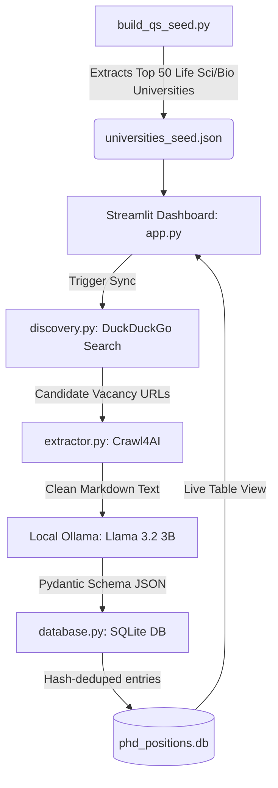

# Automated PhD Discovery Engine

An end-to-end, 100% free-to-use, zero-cost intelligence pipeline designed to automate the discovery and tracking of open PhD positions across **Life Sciences**, **Computational Biology**, **Bioinformatics**, **Systems Biology**, and **Metabolic Modelling**.

The system dynamically scrapes institutional rankings, uncovers active vacancy portals without paid search APIs, renders dynamic JavaScript-heavy sites with anti-bot bypass, extracts structured schema details locally using local LLMs on Apple Silicon GPU, and organizes all findings into an interactive dashboard.

---

## Tech Stack & Architecture

| Component | Technology | Cost | Description |
| :--- | :--- | :--- | :--- |
| **Rankings Target Seeder** | `Playwright` + `rapidfuzz` | Free | Headless extraction from QS Rankings with automatic institutional domain mapping |
| **Web Search Discovery** | `ddgs` (DuckDuckGo Engine) | Free | Real-time URL query engine; no API keys, rate limits, or tokens |
| **Web Scraping & Rendering** | `crawl4ai` (Stealth Mode) | Free | Headless Chromium engine equipped with `magic=True` to bypass Cloudflare 403 blocks |
| **Structured LLM Extraction** | `Ollama` (`llama3.2:3b`) | Free | Local on-device Apple Silicon GPU inference using strict Pydantic JSON schemas |
| **Database Storage** | SQLite (`sqlite3`) | Free | Deduplication engine using SHA-256 fingerprinting |
| **User Interface** | `Streamlit` | Free | Interactive dashboard with real-time sync control and regional/application filtering |

---

## 🔄 Pipeline Workflow



---

## Key Features

* **Zero-Cost Operation:** No OpenAI, Tavily, or Google Cloud API subscriptions required.
* **Local Inference:** Runs private, high-speed structured extractions directly through Apple Silicon's unified memory.
* **Anti-Bot Evasion:** Stealth scraping capabilities bypass Cloudflare protection and anti-bot filters on academic sites.
* **Filetype Safeguards:** Automated filters ignore `.pdf`, `.docx`, and syllabus downloads to maintain browser stability.
* **Deterministic Deduplication:** Generates unique cryptographic hashes for every position `(university + title + deadline)` to prevent duplicate entries.

---

## Sample Discovery Run (First 17 Leads)

The table below reflects findings captured during the initial deployment run. For the full dataset, see [`sample_leads.csv`](./sample_leads.csv).

| University | Region | Position Title | Application Mode | Deadline | Application Portal |
| :--- | :--- | :--- | :--- | :--- | :--- |
| **The University of Edinburgh** | Europe | PhD, MScR in Genetics & Molecular Medicine | `portal_based` | Rolling | [View Portal](https://study.ed.ac.uk/programmes/postgraduate-research/838-genetics-and-molecular-medicine-mrc-human-genetics-unit#applying) |
| **The University of Edinburgh** | Europe | PhD in Informatics: Machine Learning & Computational Biology | `portal_based` | Rolling | [View Portal](https://study.ed.ac.uk/programmes/postgraduate-research/489-informatics-iml-machine-learning-computational-neuroscience#applying) |
| **Yale University** | North America | PhD Student in Computational Biology & Biomedical Informatics | `portal_based` | Dec 1, 11:59pm ET | [View Portal](https://gsas.yale.edu/programs-of-study/biological-biomedical-sciences-bbs) |
| **UC San Francisco** | North America | PhD in Biological and Medical Informatics | `portal_based` | Rolling | [View Portal](https://gradapp.ucsf.edu/register/apply) |
| **Imperial College London** | Europe | PhD Research Opportunities in Life Sciences | `hybrid` | Rolling | [View Portal](https://www.imperial.ac.uk/life-sciences/postgraduate/research/phd-opportunities/) |

*(To inspect all 17 leads extracted in this run, open the exported [`sample_leads.csv`](./sample_leads.csv) file).*

---

## Installation & Setup

### 1. Prerequisites
- macOS with Python 3.11+
- [Ollama](https://ollama.com) installed and active

Pull the local extraction model:
```bash
ollama pull llama3.2:3b
```

---

### 2. Virtual Environment Setup

```bash
# Clone the repository
git clone [https://github.com/bhagwatigb/phd-discovery-engine.git](https://github.com/bhagwatigb/phd-discovery-engine.git)
cd phd-discovery-engine
```

# Create and activate environment
python3.11 -m venv phd_discovery_env
source phd_discovery_env/bin/activate

# Install dependencies
pip install -r requirements.txt

# Install Playwright browser binaries
playwright install chromium

---

### 3. Generate University Targets

Run the seeder once to target the Top 50 institutions across North America, Europe, and Latin America:

```bash
python build_qs_seed.py
```
---

### 4. Launch the Dashboard

Ensure the Ollama application is active in your menu bar, then launch Streamlit:

```bash
streamlit run app.py
```

Click "Run Daily Sync" to initiate discovery, live extraction, and database cataloging.

--

## Repository Structure
Plaintext<br>
├── app.py                  # Streamlit dashboard and user controls<br>
├── discovery.py            # Free search discovery via DuckDuckGo<br>
├── extractor.py            # Crawl4AI scraper and Ollama extraction engine<br>
├── database.py             # SQLite deduplication and storage schema<br>
├── build_qs_seed.py        # Automated QS Rankings target generator<br>
├── universities_seed.json  # Target institutions, domains, and regions<br>
├── requirements.txt        # Pinned project dependencies<br>
├── .gitignore              # Ignores venv, local databases, and temporary files<br>
└── sample_leads.csv        # Snapshot of exported candidate position<br>
